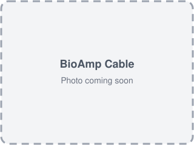
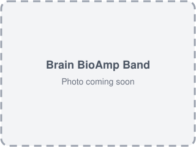
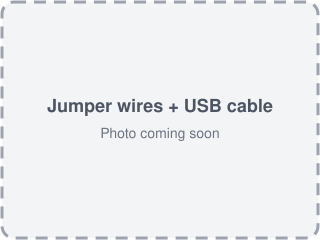
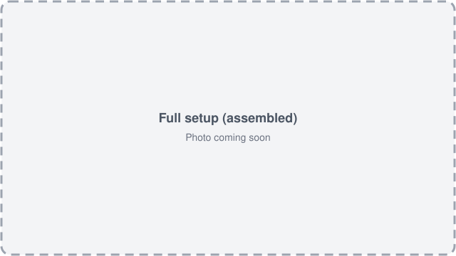

# Arduino-EEG

EEG experiments with Upside Down Labs' [BioAmp](https://github.com/upsidedownlabs/Brain-BioAmp-Arduino-Firmware) hardware and an Arduino UNO, building on their [EEG filter example](https://github.com/upsidedownlabs/Brain-BioAmp-Arduino-Firmware/blob/main/02-eeg-filter/02-eeg-filter.ino), including a 3D brain visualization that glows with live EEG band activity.

**Live visualization:** https://kkruege.github.io/Arduino-EEG/ (after GitHub Pages is turned on, see below)

## Contents

| File | What it does |
|---|---|
| `eeg_filter/eeg_filter.ino` | Filters the EEG signal (0.5–29.5 Hz) and plots it in the Arduino Serial Plotter, with an envelope line. |
| `eeg_bands/eeg_bands.ino` | Splits the signal into Delta, Theta, Alpha and Beta bands and outputs each band's amplitude. |
| `index.html` | 3D brain visualization that reads `eeg_bands.ino` output over USB and pulses in a different color for each band. |

## Materials

| Photo | Item | Where to buy | Notes |
|---|---|---|---|
|  | **BioAmp EXG Pill** | [Upside Down Labs on Tindie](https://www.tindie.com/products/upsidedownlabs/bioamp-exg-pill/) | The biopotential amplifier. Needs header pins soldered if yours came unassembled. |
|  | **Arduino UNO** | [Adafruit](https://www.adafruit.com/product/4806) · [Arduino Store](https://store.arduino.cc/products/arduino-uno-rev3) | Reads the amplified signal on pin A0. If the UNO is out of stock at Adafruit, their [Metro 328](https://www.adafruit.com/product/2488) is a compatible substitute (it uses a Micro USB cable instead). |
|  | **BioAmp Cable** | [Upside Down Labs on Tindie](https://www.tindie.com/stores/upsidedownlabs) | Connects the electrodes to the Pill's IN+, IN− and REF. Usually included in Upside Down Labs kits. |
|  | **Brain BioAmp Band** (electrode headband) | [Upside Down Labs on Tindie](https://tindie.com/products/upsidedownlabs/brain-bioamp-band-multi-channel-eeg-band) | Holds the two forehead electrodes (IN+ and IN−). |
|  | **Gel electrodes** | [Upside Down Labs on Tindie](https://www.tindie.com/stores/upsidedownlabs) | Used for REF behind the ear. Can also be used instead of a headband for all three electrodes. |
|  | **Backyard Brains EEG Headband** (alternative) | [Backyard Brains](https://backyardbrains.com/products/eegheadband) | Another headband option for the forehead electrodes. |
|  | **3 jumper wires** + **USB cable** for the UNO | USB A-to-B cable: [Adafruit](https://www.adafruit.com/product/62) · [DigiKey](https://www.digikey.com/en/products/result?keywords=102-1030-BE-F0100) | The UNO uses a **USB A-to-B** cable (the square "printer" plug). Female-to-male jumpers work with the Pill's header pins. |

**Electrode options:** use either the **Brain BioAmp Band**, **three gel electrodes**, or the **Backyard Brains headband** for the two forehead electrodes. In all cases, REF goes on a gel electrode behind the ear.

<!-- To add your photos: upload them to the images/ folder, then change the matching
     "images/photo-....svg" path above to your file name (for example images/photo-arduino-uno.jpg). -->

## Wiring

**BioAmp EXG Pill → Arduino UNO**

| BioAmp EXG Pill | Arduino UNO | Wire color in diagram |
|---|---|---|
| VCC | 5V | Red |
| GND | GND | Black |
| OUT | A0 | Orange |

> ⚠️ **Double-check VCC and GND before plugging in.** Swapping them will destroy the BioAmp EXG Pill. Always follow the labels printed on the board, not the position of the pins or the wire colors.

If you connect OUT to a pin other than A0, change `INPUT_PIN` at the top of the sketch to match.

**Electrodes → BioAmp EXG Pill** (through the BioAmp Cable)

| Electrode | Where it goes on your head | Pill input |
|---|---|---|
| Forehead, left | On the forehead, under the headband | IN+ |
| Forehead, right | On the forehead, a few cm from IN+ | IN− |
| Reference | Bony area behind the ear (mastoid), on a gel electrode | REF |

Cable colors differ between kits, so go by the **IN+ / IN− / REF** labels on the board and cable.

## Setup steps

1. Wire the BioAmp EXG Pill to the Arduino UNO as shown above. Check VCC and GND twice.
2. Plug the UNO into a **laptop running on battery** (unplugged from the wall). This is safer while electrodes are on your body, and reduces 50/60 Hz mains noise.
3. Upload a sketch from this repository with the Arduino IDE (**Tools → Board → Arduino UNO**).
4. Clean the skin where the electrodes go (forehead and behind the ear) to remove oil and makeup.
5. Put on the headband with the electrodes on your forehead, and stick the gel electrode for REF behind your ear.
6. Connect the electrode cable to the Pill's IN+, IN− and REF.
7. Open the Serial Plotter (for `eeg_filter`) or the 3D visualization (for `eeg_bands`). Blink a few times: you should see clear spikes, which confirms everything is connected.
8. Sit still with your face relaxed. Unplug the electrodes from your body before disconnecting or rewiring anything.

> This is an educational and hobby project, not a medical device.

## Full setup

## Running the 3D visualization

1. Upload `eeg_bands/eeg_bands.ino` to the Arduino.
2. Close the Arduino IDE's Serial Monitor and Serial Plotter, so the port is free.
3. Open the visualization in **Chrome or Edge**: either the GitHub Pages link above, or `index.html` downloaded to your computer.
4. Click **Connect Arduino** and choose the board's port. Or click **Demo** to see it with simulated data.

| Band | Range | Color |
|---|---|---|
| Delta | 0.5–4 Hz | Purple |
| Theta | 4–8 Hz | Blue |
| Alpha | 8–13 Hz | Green |
| Beta | 13–30 Hz | Orange |

Each band's brightness is relative to its own average over the last ~20 seconds. The pulse speeds are slowed down so they're visible, and the spread across the brain is artistic: two forehead electrodes can't tell where in the brain activity comes from.

## Notes

- Values are raw ADC counts after amplification, not calibrated microvolts.
- At the forehead, eye blinks (Delta) and facial and jaw muscle activity (Beta) are much larger than brain activity.

## Turning on GitHub Pages

In this repository, go to **Settings → Pages**, set **Branch** to `main` and `/ (root)`, and click **Save**. The page appears at the link above after a minute or two.

## Credits and license

The Arduino sketches are modified from Upside Down Labs' **02-eeg-filter.ino** in [Brain-BioAmp-Arduino-Firmware](https://github.com/upsidedownlabs/Brain-BioAmp-Arduino-Firmware/blob/main/02-eeg-filter/02-eeg-filter.ino), © 2021 Upside Down Labs, used under the MIT License. The full license notice is included at the top of each sketch.

What was changed:

- **`eeg_filter.ino`:** same 0.5–29.5 Hz filter as the original, with output reformatted for the Serial Plotter (labeled lines, fixed Max/Min bounds, slower scrolling), a start-up spike skip, and an added amplitude envelope.
- **`eeg_bands.ino`:** keeps the original 256 Hz sampling timer and biquad filter structure, but replaces the single band-pass filter with four band filters (Delta, Theta, Alpha, Beta) and outputs each band's amplitude.
- **`index.html`:** new. A 3D visualization built with [Three.js](https://threejs.org/) (MIT License) that reads the `eeg_bands.ino` output.

If you use Upside Down Labs' hardware and code, please consider supporting them by buying from [Upside Down Labs](https://upsidedownlabs.tech/).
